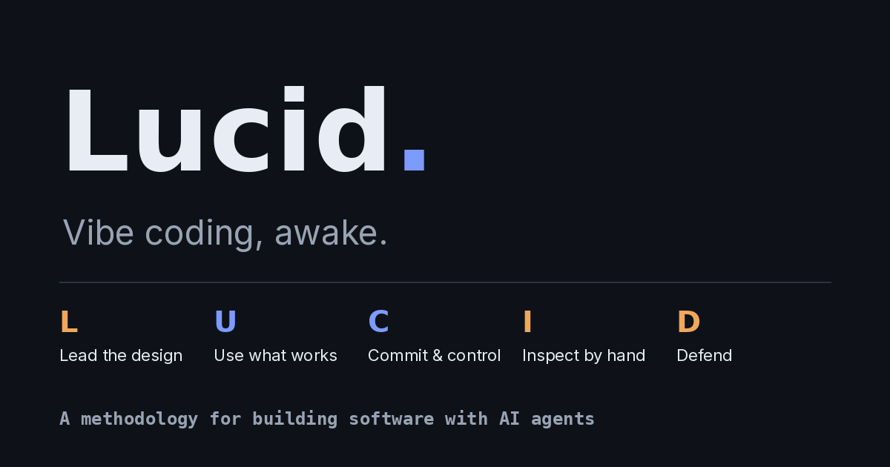

<p align="center">
  <a href="README.md">English</a> · <b>Español</b>
</p>

<p align="center">
  
</p>

<p align="center">
  <a href="https://opcastil11.github.io/lucid-coding/"><b>Manifiesto</b></a> ·
  <a href="https://opcastil11.github.io/lucid-coding/guia.html"><b>Guía (ES)</b></a> ·
  <a href="https://opcastil11.github.io/lucid-coding/guide.html"><b>Guide (EN)</b></a> ·
  <a href="SIGNATORIES.md"><b>Firmar</b></a>
</p>

<p align="center">
  
  
  
  
</p>

# Lucid coding

**Vibe coding, despierto.** Lucid coding es una metodología para construir software con agentes de IA a toda velocidad, mientras el humano sigue a cargo del diseño, las pruebas y la seguridad.

La idea viene del sueño lúcido: el sueño y su velocidad siguen iguales, pero sabes que estás soñando y puedes dirigirlo. El agente ejecuta; el humano diseña y defiende; los dos inspeccionan.

> **Respaldado por datos:** 21.310 prompts · 1.548 sesiones · 195 proyectos · 11 meses de trabajo diario con agentes de IA.

## Contenido

- [El manifiesto](#el-manifiesto)
- [LUCID en cinco letras](#lucid-en-cinco-letras)
- [Los siete pilares](#los-siete-pilares)
- [Reglas operativas](#reglas-operativas)
- [Antipatrones que corrige](#antipatrones-que-corrige)
- [Evidencia](#evidencia)
- [Empezar en cuatro semanas](#empezar-en-cuatro-semanas)
- [Firmar el manifiesto](#firmar-el-manifiesto)
- [Preguntas frecuentes](#preguntas-frecuentes)
- [Licencia y cita](#licencia-y-cita)

## El manifiesto

> Construimos software con agentes de IA todos los días. Conservamos su velocidad, pero programamos despiertos. Por eso valoramos:
>
> **Arquitectura decidida por humanos** sobre código que la IA improvisa
> **Plantillas y repos que ya funcionan** sobre construir desde cero
> **Ejecución continua, cambio a cambio** sobre planes largos sin commits
> **Producto probado a mano** sobre cobertura automática que nadie miró
> **Seguridad revisada por una persona** sobre confianza ciega en la IA
>
> Lo de la derecha tiene valor y lo usamos: la IA genera código y escribe tests. Pero cuando hay conflicto, gana lo de la izquierda.

**Regla cero:** el agente se equivoca con total seguridad. Verifícalo todo.

## LUCID en cinco letras

| | Español | English | Quién lleva | Pilares |
|:-:|---|---|---|---|
| **L** | Liderar el diseño | Lead the design | 🟧 humano | Arquitectura |
| **U** | Usar lo que funciona | Use what works | 🟦 IA guiada | Bases · Método |
| **C** | Commit y control | Commit & control | 🟦 IA trazada | Proceda · Control y auditabilidad |
| **I** | Inspeccionar todo | Inspect everything | 🟧🟦 humano o agente | QA |
| **D** | Defender | Defend | 🟧 humano | Seguridad |

## Los siete pilares

| # | Pilar | En una línea |
|:-:|---|---|
| I | **Bases** | Partir de código y arquitecturas que ya existen y que conoces. Plantillas antes que empezar de cero. |
| 0 | **Arquitectura** | El alma del código: qué construir y cómo. Ahí vive la creatividad del humano, y no se delega. |
| 1 | **Proceda** | Siempre hacia adelante. En la ejecución manda la IA: terminal, navegador y todo lo que pueda hacer. No devuelve trabajo. |
| 2 | **Método** | Plantillas de método por tipo de construcción, convertidas en reglas duras. Cada error que se repite pasa a ser una regla nueva. |
| 3 | **QA** | QA de producto intensivo y sobre todo humano, elemento por elemento. La IA automatiza unit tests y automatizaciones controladas. |
| 4 | **Seguridad** | Se sigue programando «a mano» y se le dedica todo el tiempo de revisión disponible. **Nunca se delega al 100 % en la IA.** |
| 5 | **Control y auditabilidad** | En equipo se registran sesiones y prompts, ligados a sus commits. Una política escrita de uso de IA permite auditar la seguridad del código y el uso de credenciales. |

## Reglas operativas

0. **Contexto acotado y gestión de tokens.** Cada cambio cabe entero antes de la primera compactación y cumple un ciclo GIED completo (Generar, Integrar, Evaluar, Depurar). El contexto por turno ronda los 25k tokens (mediana), pero el 52 % de las sesiones compactó: hay que cerrar y abrir sesión a tiempo, no pedir más ventana.
1. **Prompts cortos y directos.** Lo permanente va en el archivo de contexto, no en cada mensaje.
2. **Un cambio por prompt.** Otra IA tiene que poder auditarlo solo con el prompt y el diff.
3. **Referencias concretas, nunca adjetivos.** Una URL, un repo, el nombre técnico exacto y un caso de prueba.
4. **Opciones numeradas.** El agente propone 2 o 3 caminos y el humano responde con un número. «Proceda» siempre dice con qué.
5. **Cada prompt termina en un commit.** Pocas ramas activas, cada una con un propósito claro.
6. **Varios agentes, ramas separadas.** Una rama y un worktree por agente, sin excepción. El líder reparte encargos acotados, cada subagente parte con contexto limpio y devuelve un resumen, y el líder integra. (Último mes: 1.022 subagentes, ~2.490 operaciones con worktrees.)
7. **Credenciales definidas, inventariadas y rotables.** Variables de entorno y un vault. Si en desarrollo le entregas una llave al agente, entra al inventario y se rota antes de producción.
8. **Lo que funcionó dos veces se vuelve skill.** Skills precargadas de arranque, cierre, deploy y QA en navegador. El agente no reinventa: carga. (Último mes: ~9.000 acciones de navegador, ~30 invocaciones de skills.)
9. **El modelo más capaz por defecto.** Los rápidos solo en subagentes cuyo resultado se verifica; arquitectura, seguridad y auditorías nunca bajan de modelo. (Último mes: ~99 % de las respuestas del modelo tope.)

Además, el agente tiene tres órdenes permanentes:
- sospechar de todo lo que reporta;
- correr pruebas e2e y revisar producción;
- enfrentarse a un **agente adversario con contexto limpio**, que ataca el código con reglas escritas de antemano.

## Antipatrones que corrige

| Antipatrón | Síntoma | Lo corrige |
|---|---|---|
| El backlog vive en la cabeza del agente | «¿Qué queda?» todos los días | Archivo BACKLOG + evento de cierre |
| Sesiones gigantes y multitema | El agente compacta y olvida el plan | Regla 0 |
| «Proceda» sin objeto | El agente adivina qué aprobaste | Regla 4 |
| Creerle al agente | «Listo» sin prueba; el bug aparece en producción | Regla cero, e2e |
| El que construye se revisa a sí mismo | El agente defiende su propio código | Agente adversario |
| Seguridad delegada a la IA | Nadie leyó el código de autenticación | Pilar 4 |
| Credenciales sin inventario | Llaves de desarrollo llegan a producción sin rotar | Regla 7 |

## Evidencia

Lucid coding sale de un año de trabajo diario de un programador con agentes de IA, con todo el historial medido: cada prompt tecleado entre noviembre de 2025 y octubre de 2026 y cada archivo de contexto de sus proyectos. Las compactaciones salen de los transcripts que la herramienta conserva (el último mes). **Cada regla de Lucid coding sale de estos datos.** Los conteos se hicieron con expresiones regulares y son aproximados.

| Señal | Medida | Qué reveló |
|---|---:|---|
| Prompts analizados | 21.310 | 1.548 sesiones, 195 proyectos |
| Mensajes de tres palabras o menos | 27 % | El humano dirige más de lo que especifica |
| «Proceda» y variantes | ~1.230 | Aprobar es el acto principal |
| «¿Qué queda?» / «¿Cerramos?» | ~410 | El backlog vivía en el agente |
| Compactaciones en el último mes | 840 | Una cada ~6 prompts; el 52 % de las sesiones compactó |
| Quejas de diseño, logo e i18n | ~360 | Requisitos que nunca se escribieron |
| Archivos de contexto / el más grande | 135 / 226 KB | La memoria del agente crecía sin techo |

Con este ciclo, un producto SaaS completo pasó de idea a producción en 17 horas.

**Mide tus propios transcripts y compara.** Para eso se publica.

### Audita tus sesiones

[`tools/lucid_audit.py`](tools/lucid_audit.py) lee tus transcripts de Claude Code y le da a cada sesión un puntaje con una sugerencia concreta por regla incumplida: compactaciones, «proceda» sin objeto, «¿qué queda?», ediciones sin commit ni pruebas, subagentes sin worktree, elección de modelo y secretos pegados en prompts. Solo usa la biblioteca estándar, corre local y nunca imprime el texto de los prompts.

```bash
python3 tools/lucid_audit.py --lang es     # últimos 30 días, 10 sesiones a revisar
python3 tools/lucid_audit.py --days 0 --top 25 --lang es
python3 tools/lucid_audit.py --json > auditoria.json
```

## Empezar en cuatro semanas

| Cuándo | Paso | Qué hacer |
|---|---|---|
| Semana 1 | **Montar** | Crear los cinco archivos (CONTEXTO, INVARIANTES, BACKLOG, ESTADO, BITÁCORA) y escribir las invariantes. Configurar variables de entorno, vault e inventario de credenciales. Guardar las plantillas de arranque y cierre. |
| Semanas 2–3 | **Practicar** | Cada prompt termina en commit, cada sesión cierra antes de compactar y cada hito pasa por la compuerta humana. Registrar las fricciones. |
| Semana 4 | **Medir** | Contar compactaciones por sesión, «¿qué queda?» y correcciones de diseño. Comparar con lo de antes y ajustar. |

## Firmar el manifiesto

Si compartes los valores, agrega una línea en [`SIGNATORIES.md`](SIGNATORIES.md) y abre un pull request titulado `Sign: <tu nombre>`. Los detalles están en [`CONTRIBUTING.md`](CONTRIBUTING.md).

Los reportes de experiencia valen todavía más: qué probaste, en qué tipo de proyecto y qué pasó. Abre un issue con la plantilla **Experience report**.

## Preguntas frecuentes

**¿Está contra el vibe coding?** No. Conserva la velocidad y le suma conciencia. Lo de la derecha del manifiesto sigue teniendo valor.

**¿Está atado a una herramienta?** No. Se desarrolló con Claude Code, pero los conceptos son genéricos: archivo de contexto (CLAUDE.md, AGENTS.md…), ramas aisladas y procedimientos escritos.

**¿Para quién es?** Para programadores que ya trabajan con agentes de IA. El pilar de Seguridad exige saber leer código.

**¿Por qué «proceda»?** Es la palabra que más se tecleó en las sesiones medidas, y fue el nombre de trabajo del método.

## Licencia y cita

El manifiesto y la guía usan la licencia [CC BY-SA 4.0](LICENSE): puedes copiarlos, traducirlos y adaptarlos citando la fuente y con la misma licencia. Los datos para citar están en [`CITATION.cff`](CITATION.cff).
